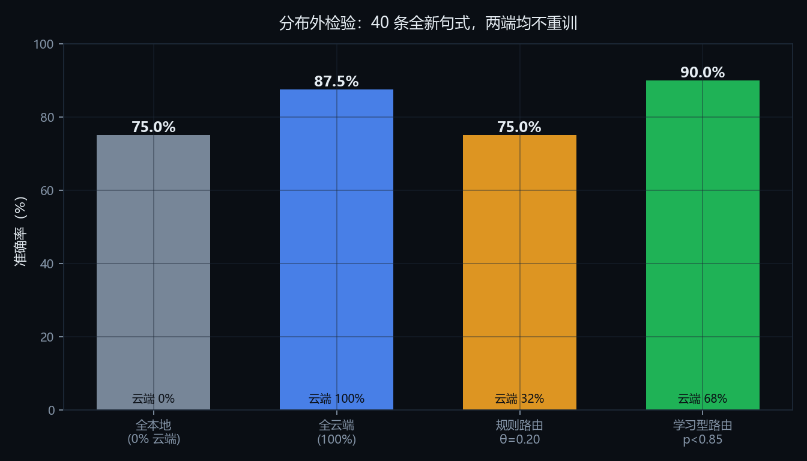
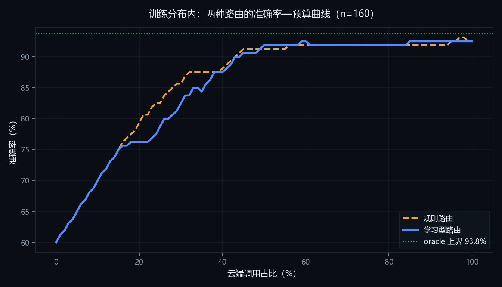

# HybridMind · 端云协同的自适应大模型路由

> 2026 第九届传智杯 · AI 大模型创新应用挑战赛（个人赛 · B 组）参赛作品
> 参赛者：张云迪（商洛学院）

## 交付物一览

| 交付物 | 位置 | 说明 |
| --- | --- | --- |
| 在线演示 | <https://hanyue0-hybridmind.ms.show> | ModelScope 创空间，2 vCPU / 8 GB，本地模型与云端均可用 |
| 演示视频 | [docs/HybridMind_演示视频_最终版.mp4](docs/HybridMind_演示视频_最终版.mp4) | 5:02，1920×1080，普通话讲解 + 字幕 |
| 技术文档 | [docs/HybridMind_技术文档.pdf](docs/HybridMind_技术文档.pdf) | 25 页（限制 30 页） |
| 代码仓库 | 本仓库 | 46 次提交，按模块推进；22 项单元测试 |

**一句话**：在用户和大模型之间加一层路由——预测「本地模型能不能答对这道题」，判得准就留在本地（零 API 费用、数据不出机），判不准才升级云端大模型；本地答完还会自评置信度，仅在不确信时才重答。目标是在「准确率—成本—延迟—隐私」之间拿到可配置的平衡点。

## 实测结果（2026-10-24 ~ 25，本机 i5-13420H / 16GB 单通道 / 无独显）

全本地基线，160 条封闭答案题目：

| 难度档 | 题目形态 | 样本 | 本地准确率 |
| --- | --- | --- | --- |
| tier1 | 单步运算 | 60 | 98.3% |
| tier2 | 两步运算 | 50 | 68.0% |
| tier3 | 三步/百分比 | 30 | 10.0% |
| tier4 | 多步推理 | 20 | 0% |
| 合计 | | 160 | **60.0%** |

- 本地吞吐 **3.2–4.1 tok/s**（单通道内存带宽受限，非算力问题）
- 平均延迟 6.27 s，P95 16.3 s
- 云端调用成本 **¥0**（全本地），换来的代价是两步以上准确率断崖

**顺带暴露的问题**：规则路由器在 θ=0.45 时，160 条里只把 1 条判给云端（0.6%），
难度分在 0.13–0.33 之间几乎不随真实难度变化。这说明**字符串规则描述的是"题目写法"，
不是"模型会不会做错"**——这正是 v0.2 改用学习型路由（以真实作答结果作标签）的动因。

### 学习型路由：分布外检验才是真章

用 160 条真实作答当标签训练逻辑回归（14 维题面特征），**5 折交叉验证 AUC = 0.9355**。
在训练分布内它与规则路由打平（56% 云端占比、91.9% 准确率）；但换一批**全新句式**的 40 条题
（两端都不重训），差距立刻拉开：

| 策略 | 云端占比 | OOD 准确率 |
| --- | --- | --- |
| 全本地 | 0% | 75.0% |
| 全云端 | 100% | 87.5% |
| 规则 θ=0.20 | 32% | **75.0%（等于没路由）** |
| **学习型 p<0.85** | 68% | **90.0%（超过纯云端）** |

同等 30% 云端预算下，学习型比规则高 **12.5 个百分点**。



而在训练分布内，规则路由反而略占上风（它的特征词表就是照着这批题调的）：



原因：规则的特征词是「计算/求解/多少/单价」，OOD 题目说的是「还剩几元/每组几人」，
一个词都没命中，难度分从均值 0.33 塌到 0.14，于是全部留在本地。
**规则学到的是"这批题的写法"，学习型学到的是"模型的能力边界"。**

完整数据与失败样例见 [`docs/results.md`](docs/results.md)，
训练细节见 [`docs/router_report.md`](docs/router_report.md)。

## 为什么做这个

部署一个 AI 应用时，最现实的两难是：

- **全用云端大模型**：答得准、响应快，但每次都要付钱、要连网、数据要出门；
- **全用本地小模型**：零边际成本、数据不出本机、断网也能用，但稍微绕一点的问题就开始胡说。

真实的流量分布是长尾的：**大部分请求很简单，少数很难**。把简单请求也送去云端，
等于为「1+1 等于几」付大模型的钱；把难请求留在本地，则等于拿准确率赌运气。
HybridMind 做的就是这条分界线上的决策，并把它**做成可看、可测、可调的**——
而不是藏在代码里的一句 `if`。

需要先说清楚一件事，因为它是被实测推翻后才想明白的：**在单机、单用户的量级上，
路由省下的钱微不足道**（本机实测云端千次调用仅 ¥0.19）。所以这个方案的真实价值是：

| 价值 | 说明 |
| --- | --- |
| 隐私 | 可判定为简单的请求根本不出设备 |
| 可用性 | 断网、限流、密钥失效时本地仍能服务 |
| 规模化成本 | 亿级调用时，本地承担的比例直接决定账单 |
| 准确率 | 靠路由把难题交给云端，逼近 oracle 上界 |

延迟和准确率在弱设备上是云端占优的——这一点写在 `docs/results.md` 里，没有藏。


## 核心设计

```
用户提问
   │
   ▼
┌──────────────────────────┐
│ 难度特征提取（纯规则）      │  长度/数学/代码/推理词/多问句/递进连词
└──────────┬───────────────┘
           ▼
     难度分 vs 阈值 θ
           │
     ┌─────┴─────┐
     ▼           ▼
  本地 1.5B    云端大模型
     │
     ▼
  自评置信度 < τ ？──是──▶ 升级云端重答
     │否
     ▼
  返回答案 + 路由凭证（走了哪条路、为什么、花了多少钱）
```

三个刻意的设计选择：

1. **不用大模型判断难度**。若路由本身要调一次云端，等于每次请求先付一遍钱，方案立论就崩了。所以特征提取全是字符串规则，零成本、零延迟、可复现。
2. **可解释性由设计保证**。路由理由是由特征名直接拼出来的自然语言（"命中数学运算特征 ×2"），不是事后用另一个模型"解释"一个黑箱。
3. **判分不请大模型当裁判**。评测集全部是封闭答案（数值题比数值，短答题比别名），评委可逐条复算，避免"用 A 证明 A 很准"。

> 📄 **技术文档（25 页 PDF）**：[docs/HybridMind_技术文档.pdf](docs/HybridMind_技术文档.pdf)

## 快速开始

```bash
# 1. 依赖
python -m venv .venv
.venv\Scripts\pip install -r requirements.txt   # Windows
# source .venv/bin/activate && pip install -r requirements.txt  # macOS/Linux

# 2. 本地模型（约 1GB）
ollama pull qwen2.5:1.5b

# 3. 配置云端（可选，不配则自动降级为纯本地）
copy .env.example .env    # 填入 CLOUD_API_KEY

# 4. 生成评测集
.venv\Scripts\python scripts\gen_eval_set.py

# 5. 启动演示
.venv\Scripts\python -m uvicorn app.web.main:app --port 8000
# 浏览器打开 http://127.0.0.1:8000
```

没有 GPU 也能跑：本作品在一台 i5-13420H / 16GB / 无独立显卡的笔记本上开发和评测，
本地推理走 CPU，这正是该方案的典型目标场景。

## 评测

```bash
python -m app.eval.run_eval --mode local     # 全本地基线
python -m app.eval.run_eval --mode cloud     # 全云端基线
python -m app.eval.run_eval --mode auto      # 路由
python -m app.eval.run_eval --mode auto --theta 0.6   # 扫阈值
```

输出一张可直接贴进技术文档的对照表，并把逐条明细写入 `data/results/`，用于失败案例分析。

## 目录结构

```
app/
  config.py              全部可调参数（阈值、价格表、预算）
  schemas.py             请求/响应/路由凭证的数据结构
  pipeline.py            编排：决策 → 推理 → 兜底 → 记账
  providers/             本地(Ollama) / 云端(OpenAI 兼容) 同构适配
  router/                特征、策略、置信度
  eval/                  判分口径、评测执行、结果落盘
  web/                   FastAPI + 零依赖前端
scripts/gen_eval_set.py  评测集生成（固定随机种子，可复现）
tests/                   路由与判分的单元测试
docs/ai-logs/            AI 协作过程记录（原创性证据）
```

## 配置项

| 变量 | 默认 | 说明 |
| --- | --- | --- |
| `LOCAL_MODEL` | `qwen2.5:1.5b` | 本地模型，2GB 内存以下可换 `qwen2.5:0.5b` |
| `CLOUD_MODEL` | `deepseek-chat` | 任何 OpenAI 兼容模型 |
| `THETA_LOCAL` | `0.45` | 难度阈值，越大越省钱、越小越准 |
| `TAU_CONFIDENCE` | `0.55` | 本地自评低于此值则升级重答 |
| `ENABLE_ESCALATION` | `1` | 置信度兜底开关（消融实验用） |

## 已知局限

- 路由用规则特征，对**换了表述的同类难题**可能判低（评测中已单列失败案例）；
- 自评置信度并不可靠，只能缓解不能消除误判，所以专门做了关闭兜底的消融对照；
- 本地模型能力上限决定了"省钱但答错"的天花板，阈值需要按业务调。

## 许可

仅用于本届传智杯参赛与评审。第三方组件（Ollama、Qwen、FastAPI）遵循各自许可证。
