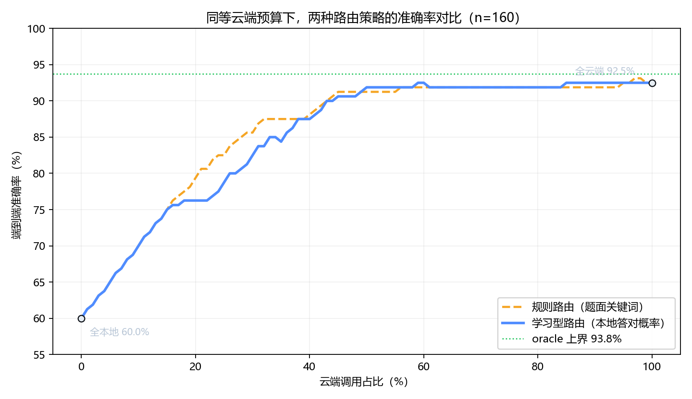

# 同等云端预算下的路由质量对比

| 云端预算 | 规则路由 | 学习型路由 | 提升 |
| --- | --- | --- | --- |
| 20% | 79.4% | 76.2% | -0.0 pt |
| 30% | 85.6% | 82.5% | -0.0 pt |
| 40% | 88.1% | 87.5% | -0.0 pt |
| 50% | 91.2% | 91.9% | +0.0 pt |
| 60% | 91.9% | 92.5% | +0.0 pt |
| 70% | 91.9% | 91.9% | +0.0 pt |

oracle 上界：93.8%

